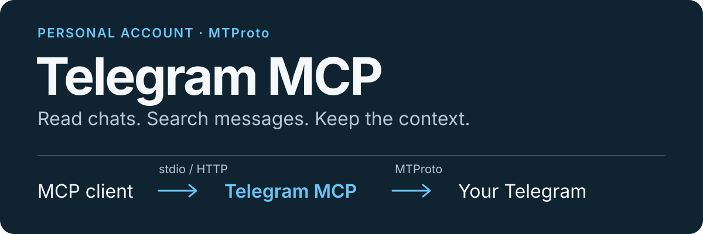

# Telegram MCP

<p align="center">
  
</p>

An MCP server for reading and searching chats, groups, and channels visible to **your personal Telegram account**. Clients connect over stdio or authenticated HTTP; Telegram is reached over MTProto, so no Bot API or bot token is involved.

[Get started](#getting-started) · [Connect a client](#client-setup) · [HTTP hosting](#http-access) · [Configuration](#configuration) · [Tools](#tools)

### A tool call

After setup, ask your MCP client to call `fetch_since`:

```json
{
  "groupUrl": "@channel_username",
  "sinceId": 1234,
  "limit": 50
}
```

It returns the earliest messages after `sinceId`; pass the returned `maxId` as the next cursor.

## Getting started

Requires Go 1.26+ and an existing Telegram account.

1. **Get API credentials.** Sign in at [my.telegram.org](https://my.telegram.org), open **API development tools**, register an application if needed, and copy **App api_id** to `TELEGRAM_API_ID` and **App api_hash** to `TELEGRAM_API_HASH`. Set `TELEGRAM_PHONE` to the account number with `+` and country code, e.g. `+491234567890`. See the [official guide](https://core.telegram.org/api/obtaining_api_id). Keep credentials private.

2. **Load the environment.** `.env` is not loaded automatically; source it in your shell or process manager.

   ```sh
   cp .env.example .env
   chmod 600 .env
   # Set TELEGRAM_API_ID, TELEGRAM_API_HASH, and TELEGRAM_PHONE in .env.
   set -a
   . ./.env
   set +a
   ```

3. **Build and authorize.** Run once in an interactive terminal:

   ```sh
   go build -o bin/telegram-mcp .
   ./bin/telegram-mcp setup
   ```

   Enter the login code and, if prompted, your two-step verification (2FA) password. Codes and passwords are hidden prompts, never configuration. In-app codes arrive in the Telegram service chat of your other sessions; SMS word/phrase codes must be entered in full.

   **No code:** enter `resend` to request the next delivery method once Telegram's displayed timeout has passed. Telegram controls delivery; repeated restarts cannot force SMS, and rate limits stop setup with a retry delay. See [Telegram authorization](https://core.telegram.org/api/auth#sending-a-verification-code).

   **QR alternative:** run `./bin/telegram-mcp setup qr` and scan the code in the logged-in phone's Telegram app (Settings → Devices → Scan QR Code), then enter 2FA if prompted. No phone number or code is needed.

   Setup saves the session to `TELEGRAM_SESSION_PATH` (default `~/.telegram-mcp/session.json`, mode `0600`).

4. **Connect your client.** Shared `mcpServers` configuration:

   ```json
   {
     "mcpServers": {
       "telegram": {
         "command": "/absolute/path/to/telegram-mcp/bin/telegram-mcp",
         "env": {
           "TELEGRAM_API_ID": "123456",
           "TELEGRAM_API_HASH": "your_32_character_api_hash"
         }
       }
     }
   }
   ```

   `TELEGRAM_PHONE` is only needed for setup. Run the client as the same OS user and with the same `TELEGRAM_SESSION_PATH` (if customized) as `setup`.

Without arguments the binary serves MCP over stdio; diagnostics go to stderr. `--help` needs no credentials. Use one server process per session.

## Client setup

- **Local (stdio):** the client starts the binary under the OS user who ran `setup`.
- **Remote (HTTP):** run the server as in [HTTP access](#http-access) and connect to `https://tg.example.com/mcp` with the bearer token.

Replace example paths, credentials, domain, and token; never commit them.

### Claude Code

Local:

```sh
claude mcp add telegram -s user \
  -e TELEGRAM_API_ID=123456 -e TELEGRAM_API_HASH=your_32_character_api_hash \
  -- /absolute/path/to/telegram-mcp/bin/telegram-mcp
```

Remote:

```sh
claude mcp add telegram -s user --transport http https://tg.example.com/mcp \
  --header "Authorization: Bearer $TELEGRAM_MCP_HTTP_TOKEN"
```

Check the connection with `/mcp`.

### Claude Desktop and claude.ai

Local: **Settings → Developer → Edit Config**, add the [shared JSON](#getting-started) to `claude_desktop_config.json`, and restart.

Remote: **Customize → Connectors → Add custom connector**, URL `https://tg.example.com/mcp`, authentication **No sign-in**, request header `authorization` = `Bearer <token>`. The URL must be reachable from Anthropic's cloud. Request headers may not be available on every account ([docs](https://claude.com/docs/connectors/custom/add-unlisted#authenticate-with-request-headers)); otherwise use local setup or Claude Code.

### ChatGPT and Codex

ChatGPT developer-mode connectors can't send static bearer tokens or start local processes, so they can't use this server. Use Codex CLI or the IDE extension with `~/.codex/config.toml`.

Local:

```toml
[mcp_servers.telegram]
command = "/absolute/path/to/telegram-mcp/bin/telegram-mcp"
env = { TELEGRAM_API_ID = "123456", TELEGRAM_API_HASH = "your_32_character_api_hash" }
```

Remote (the token is read from the named environment variable):

```toml
[mcp_servers.telegram]
url = "https://tg.example.com/mcp"
bearer_token_env_var = "TELEGRAM_MCP_HTTP_TOKEN"
```

Check the connection with `/mcp`.

### Hermes Agent

Add one of these to `~/.hermes/config.yaml`, then run `/reload-mcp`. `${VAR}` is filled from the environment.

Local:

```yaml
mcp_servers:
  telegram:
    command: "/absolute/path/to/telegram-mcp/bin/telegram-mcp"
    env:
      TELEGRAM_API_ID: "123456"
      TELEGRAM_API_HASH: "your_32_character_api_hash"
```

Remote:

```yaml
mcp_servers:
  telegram:
    url: "https://tg.example.com/mcp"
    headers:
      Authorization: "Bearer ${TELEGRAM_MCP_HTTP_TOKEN}"
```

## HTTP access

After `setup`, `telegram-mcp http` serves Streamable HTTP at `http://TELEGRAM_MCP_HTTP_ADDR/mcp`:

```sh
export TELEGRAM_MCP_HTTP_TOKEN="$(openssl rand -hex 32)"   # keep it; clients need it
./bin/telegram-mcp http
# serving MCP on http://127.0.0.1:8080/mcp
```

- Every request needs `Authorization: Bearer <TELEGRAM_MCP_HTTP_TOKEN>`, otherwise `401`. The token grants all tools; protect it like the session.
- Plain HTTP binds to loopback only (`127.0.0.1`, `[::1]`, `localhost`); publish through an HTTPS reverse proxy on the same host.
- `download_media` and `get_thumbnail` save files on the server host; `view_thumbnail` returns the preview inline.
- Run it under a process manager, e.g. systemd with `ExecStart=/path/to/bin/telegram-mcp http` and `EnvironmentFile=`.

Caddy example (TLS is automatic):

```caddyfile
tg.example.com {
    reverse_proxy 127.0.0.1:8080 {
        header_up Host {upstream_hostport}
    }
}
```

Keep `header_up Host`; without it the server rejects the public `Host` header with `403 Forbidden: invalid Host header`.

## Configuration

| Variable | Default | Purpose |
| --- | --- | --- |
| `TELEGRAM_API_ID` | Required | Positive 32-bit Telegram API ID |
| `TELEGRAM_API_HASH` | Required | 32 hexadecimal characters |
| `TELEGRAM_PHONE` | Required for `setup` (unused by `setup qr`) | Phone number with country calling code |
| `TELEGRAM_SESSION_PATH` | `~/.telegram-mcp/session.json` | gotd authorized-session file |
| `TELEGRAM_DOWNLOAD_DIR` | `~/.telegram-mcp/downloads` | Directory for downloaded files |
| `TELEGRAM_MAX_DOWNLOAD_MB` | `200` | Download limit in MiB and ceiling for `maxMB`; `0` disables the limit |
| `TELEGRAM_REQUEST_TIMEOUT` | `5m` | Total timeout for a tool call, including downloads |
| `TELEGRAM_MCP_HTTP_ADDR` | `127.0.0.1:8080` | Listen address for `telegram-mcp http`; loopback hosts only |
| `TELEGRAM_MCP_HTTP_TOKEN` | Required for `http` | Bearer token, at least 32 characters; generate with `openssl rand -hex 32` |

`~/` expands to your home; relative paths resolve from the process working directory. GramJS string sessions are incompatible; run `setup` instead. Never commit `.env`, sessions, or downloads.

## Tools

`groupUrl` accepts `@username`, `https://t.me/...` links (including message links), or a numeric chat ID as a string from `list_dialogs`.

| Tool | Required parameters | Optional parameters |
| --- | --- | --- |
| `read_messages` | `groupUrl` | `limit`: 50, maximum 200; `beforeId`: only older messages; `unreadOnly`: false; `maxTextChars` |
| `search_messages` | `groupUrl`, `query` | `limit`: 30, maximum 100; `beforeId`: only older matches; `maxTextChars` |
| `fetch_since` | `groupUrl`, `sinceId` | `limit`: 100, maximum 200; `maxTextChars` |
| `get_message` | `groupUrl`, `messageId` | — |
| `global_search` | `query` | `limit`: 30, maximum 100; `maxTextChars` |
| `get_group_info` | `groupUrl` | — |
| `get_me` | — | — |
| `list_dialogs` | — | `limit`: 100, maximum 500; `archived`: false; `unreadOnly`: false |
| `list_folders` | — | — |
| `list_folder_dialogs` | `folderId` | `limit`: 100, maximum 500; `unreadOnly`: false |
| `get_pinned` | `groupUrl` | `limit`: 20, maximum 50; `maxTextChars` |
| `get_media_info` | `groupUrl`, `messageId` | — |
| `download_media` | `groupUrl`, `messageId` | `maxMB`: lowers the configured limit; `0` or omitted uses it |
| `get_thumbnail` | `groupUrl`, `messageId` | — |
| `view_thumbnail` | `groupUrl`, `messageId` | — |
| `mark_read` | `groupUrl` | `messageId`: marks up to and including it; omitted marks the whole chat |
| `save_draft` | `groupUrl`, `text` | — |

**Side effects are explicit:** only `mark_read` (advances the read cursor) and `save_draft` (replaces a chat's draft) change account state. `download_media` and `get_thumbnail` write local files; `view_thumbnail` writes none. Nothing sends, edits, or deletes messages or joins chats.

## License

[MIT](LICENSE).
